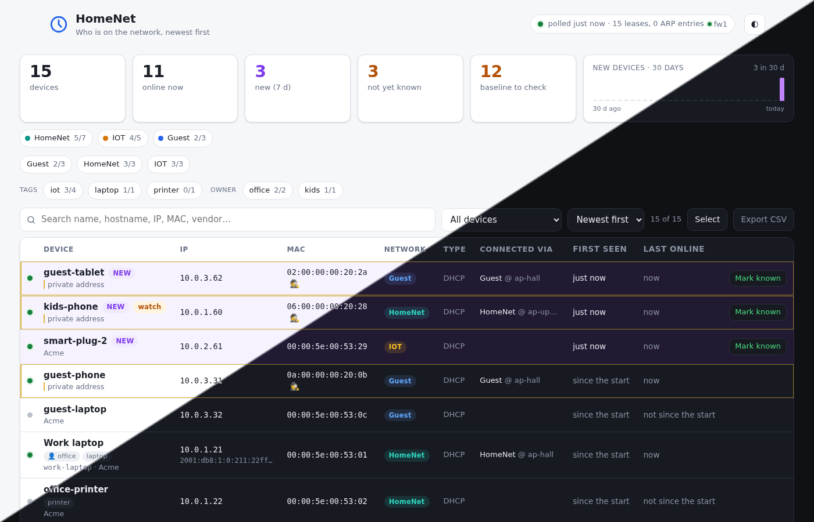

# leasewatch

**Who is on the network, newest first.** A small self-hosted page that watches an [OPNsense](https://opnsense.org/) firewall's DHCP leases and ARP table, remembers every device it has ever seen, mails you when a new one appears, and lets you name and acknowledge devices so a newcomer is noticed once and then known.

What changed between releases: [CHANGELOG.md](CHANGELOG.md).



- One row per MAC with vendor, IP, hostname, network (VLAN), lease type, first seen / last online, a history of address changes and an event log.
- **Newest first**, a "not yet known" review queue, name + note per device, CSV export, search, filters, light/dark, phone layout.
- Optional **"Connected via"**: switch port over SNMPv3 (Q-BRIDGE / IF / LLDP MIBs — any managed switch; uplink ports are named after the AP or switch behind them; tested on Comware, LLDP port numbers are mapped through `lldpLocPortId`) and Wi-Fi SSID / AP / signal from a UniFi Network controller.
- Backend: Python 3.12 standard library (`urllib`, `sqlite3`, `http.server`); the only pip dependency is `pysnmp` for the optional switch lookup. Frontend: one HTML page, vanilla JS/CSS, no build step.
- Read-only towards the firewall: only lease, reservation and ARP searches are called. The API user needs *Diagnostics: ARP Table* and the DHCP server's privilege (*Services: DHCP: Kea(v4)*, or *Services: ISC DHCPv4: Leases* for the legacy ISC server; `DHCP_BACKEND`).

## Run

```sh
cp .env.example .env && chmod 600 .env      # set FW1_URL, FW1_KEY, FW1_SECRET (and the optional sources)
install -d -o 100 -g 101 data               # the container runs as uid 100 (alpine "app")
docker compose up -d --build                # without nginx-proxy: publish port 8080 instead, see docker-compose.yml
docker compose exec leasewatch wget -qO- http://127.0.0.1:8080/api/stats   # the meta block shows the last poll; /healthz is for monitors (503 + reason on failure, which busybox wget does not print)
```
Local development: `DATA_DIR=./data LISTEN_PORT=8089 FW1_URL=… FW1_KEY=… FW1_SECRET=… python3 -m leasewatch`.

### OPNsense API user

Create a user with only the privileges *Diagnostics: ARP Table* and the leases page of the DHCPv4 server you run — *Services: DHCP: Kea(v4)* (`DHCP_BACKEND=kea`, the default; leasewatch reads the leases, `/api/kea/leases4/search`, and the reservations, `/api/kea/dhcpv4/searchReservation`; OPNsense has no read-only Kea privilege, so this one also allows configuration writes) or, for the legacy ISC server, *Services: ISC DHCPv4: Leases* (`DHCP_BACKEND=isc`; ISC DHCP is end-of-life in OPNsense and moves to a plugin from 26.1, so new installs should use Kea or dnsmasq — dnsmasq leases are not read yet) — generate an API key for it (System › Access › Users › the user › API keys) and put key and secret in `.env`. The ACL for the ARP table matches the snake_case endpoint (`get_arp`), which is what leasewatch calls.

### Optional sources

- **Switch port (SNMPv3):** a read-only v3 user on the switch with a view that includes `1.3.6.1.2.1` (mib-2) and `1.0.8802.1.1.2` (LLDP), authentication SHA or SHA-256, privacy AES-128. Set `SNMP_HOST` (a host name or IP without a port; UDP 161 is used), `SNMP_USER`, `SNMP_AUTH`, `SNMP_AUTH_KEY`, `SNMP_PRIV_KEY`. Ports with an LLDP neighbour or ≥ 6 MACs are shown as `port → what hangs there`.
  - `SNMP_PROFILE` / `SNMP_PROFILE_FILE` / `SNMP_MIN_MACS` (or `PROFILE` / `PROFILE_FILE` / `MIN_MACS` per `snmp_switch` instance, see Connectors): the SNMP profile says which tables are walked and which vendor quirks apply. Without them leasewatch detects the profile from `sysObjectID`/`sysDescr` (first match wins, else `standard`). A profile file is your own JSON profile and wins over the profile name; it may `extends` a built-in one. `MIN_MACS` (default: the profile's `uplink.min_macs`, 6) is how many MACs on a port without an LLDP neighbour make it an uplink.
  - Cisco IOS (`cisco_ios`): the forwarding table is read per VLAN through SNMPv3 contexts named `vlan-<N>`; the SNMPv3 group needs `context vlan- match prefix` (or one context per VLAN). Without them leasewatch logs "per-VLAN contexts unavailable, using Q-BRIDGE" once and reads Q-BRIDGE instead.
  - Port names are shortened on every profile (`GigabitEthernet1/0/1` → `GE1/0/1`, `Ten-GigabitEthernet` → `XGE`, `FortyGigE` → `FGE`, `HundredGigE` → `HGE`, `TwentyFiveGigE` → `TGE`, `Bridge-Aggregation` → `BAGG`, `Port-channel` → `Po`); a profile's `port_name.short` replaces the map.
- **Wi-Fi (UniFi Network):** a read-only admin on the controller; set `UNIFI_URL`, `UNIFI_USER`, `UNIFI_PASSWORD` (classic session API: `/api/login`, `/api/s/<site>/stat/sta`). The controller's device alias becomes the display name when no name or hostname exists.
- **Mail (Mailgun):** set `MAILGUN_KEY`, `MAILGUN_DOMAIN`, `MAIL_TO`; for an EU-region domain also `MAILGUN_API_BASE=https://api.eu.mailgun.net`.
- Either source failing only greys its dot in the status pill; the last values stay.

### Commands

- `python -m leasewatch snmp-profiles` lists the built-in SNMP profiles and their match rules.
- `python -m leasewatch snmp-detect <instance>` (or `--host 10.0.0.2 --auth-key-env SNMP_AUTH_KEY --priv-key-env SNMP_PRIV_KEY`) prints sysObjectID, sysDescr, the chosen profile and the first rows of each walk. Keys are read from environment variables, never from the command line. Needs pysnmp.

### Connectors

Every source (the firewall, a switch, a UniFi controller) is a *connector instance*: a configured copy of a connector type (`opnsense`, `snmp_switch`, `unifi`) that reads its device once per poll and hands leasewatch plain records; it never writes to the database or to the device. A connector emits two kinds of record: a *sighting* says a MAC was seen with an IP, hostname or network (a lease, an ARP entry) and whether it is on the wire now, and an *attachment* says where a MAC hangs (a switch port, a Wi-Fi AP and SSID). At least one instance must produce sightings.

Without `LW_CONNECTORS` the `FW1_*`, `SNMP_*` and `UNIFI_*` variables describe the instances `fw1`, `switch` and `unifi`, as before. With it, list the instance names (`a-z`, `0-9`, `-`; the order breaks ties in the merge) and configure each one with `LW_CONNECTOR__<NAME>__<KEY>`, the name upper-cased; `TYPE` is required, `TIMEOUT` (seconds, default 60) caps one collection, and any secret key also accepts `<KEY>_FILE`, a file whose content is the value (e.g. a Docker secret). The keys are the type's settings in upper case (e.g. `URL`, `KEY`, `SECRET`, `DHCP_BACKEND` for `opnsense`); see the commented block in `.env.example`. A wrong setting stops the start with a message such as `connector sw-rack (snmp_switch): HOST is required`.

Each instance collects in its own thread. One that fails, or takes longer than its `TIMEOUT`, greys its status dot and keeps its last values; a collection still running at the next poll is skipped, not doubled. An instance that fails its first probe is retried with a backoff from `POLL_SECONDS` up to 10 minutes. The poll fails only when every sighting-producing instance failed. `/api/status` shows each instance's state (`ok`, `error`, last time, duration, record count).

## API

| Method | Path | What |
|---|---|---|
| GET | `/api/devices` | all devices + collector meta |
| GET | `/api/devices/<mac>` | one device with history, events and `seen` (per connector instance: `source`, `last_seen`, `last_present`) |
| POST | `/api/devices/<mac>` | `{"acked": bool, "name": str, "note": str}` (any subset) |
| GET | `/api/stats` | counts, per-network, first-seen times of the last 30 days' newcomers |
| GET | `/api/events` | last 300 events |
| GET | `/api/status` | collector meta only, with `connectors`: one entry per instance (`name`, `label`, `type`, `ok`, `error`, `ts`, `ms`, `count`, `enabled`, `strategy` for a switch). `connectors` is the stable form; the `switch` and `unifi` objects in the meta are kept for 1.1 only and go away in 1.2 |
| GET | `/api/devices.csv` | CSV export (timestamps ISO 8601 in the container's `TZ`) |
| GET | `/healthz` | 200 when the last poll succeeded and is fresh, else 503 |

## Semantics

- **Baseline:** everything present at the very first poll is marked `baseline` — not "new", no mail, sorted after real newcomers. An empty first poll is not taken as the baseline.
- **New** = first seen within `NEW_DAYS` and not baseline. **Not yet known** = not marked known and not baseline.
- **Online** = in the ARP table now (or the lease says online), re-evaluated every poll. A device that leaves the ARP table (or is no longer listed) stays online for `ONLINE_GRACE_MINUTES` after it was last seen on the wire, then goes offline. `last_online` is the last time it was actually online; `last_seen` (CSV `last_listed`) the last time the firewall listed it at all — static mappings are always listed (under Kea, which lists only reservations with an active lease, the reservations are read for the same effect), so the UI shows *last online*.
- **History** rows are written only when IP, hostname, network or lease type change (capped at 200 per device). **Events:** new, ip, hostname, vlan, lease_type, port, wifi, back (online again after > 1 day), acked / unacked; kept for a year.
- Lease type of a device whose lease is gone (`LEASE_TYPE_MODE`): `keep` (default) keeps the last type, so an expiring lease that is still in ARP does not flap between types on every poll; `grace` clears it once the device has been listed without a lease for `ONLINE_GRACE_MINUTES` (timed in memory, so a restart starts the clock again); `immediate` clears it at the first poll without a lease. Clearing writes a `lease_type` event and a history row. `sources` shows what listed it last.
- A Wi-Fi device that leaves keeps its last SSID/AP for the record. The Wi-Fi details are dropped when the device is on the wire this poll, every controller answered and none lists it; `link` is then `wired` if a switch lists it, else empty. A controller that lists it as wired drops them too. If a controller failed this poll and none that answered lists the device, it keeps its Wi-Fi details and no switch port is taken (blind). When two controllers disagree, the first one in `LW_CONNECTORS` wins.
- **Hostname** falls back DHCP → controller client → ARP → scan; **vendor** DHCP → ARP → controller → scan. Between several rows for one MAC, rows with an empty IP or network rank last in these fallbacks, so the result does not depend on the order the firewall returns rows in.
- **Seen by** (device page): one line per connector instance that listed the device, with when it last did; "on the wire" when that instance last saw it present within `ONLINE_GRACE_MINUTES`. A listing without presence (a lease alone, an FDB entry) moves the time but not "on the wire"; a controller's active client is present (this does not change *Online*). Rows of instances no longer in the configuration are removed at startup.
- **Switch port** when several switches see a device: the first wired attachment per instance is its candidate. An edge port beats an uplink port (shown "via X"); between two edge ports the switch that already holds the device wins (if it still lists it), then the order in `LW_CONNECTORS`; between two uplinks the same. Wi-Fi beats any switch port: a client listed by the controller stays on Wi-Fi whatever the switches say. If the switch that holds a wired device fails a poll, the device keeps its port and no `port` event is written, whatever the other switches offer. The instance that placed the device is stored as `loc_source` (CSV column too). A `port` event is written only when the chosen port changes.
- Interfaces in `IGNORE_INTERFACES` (default WAN and loopback) are skipped.

## Backup and reset

- Backup: `docker compose exec leasewatch python -c "import sqlite3; sqlite3.connect('/data/leasewatch.sqlite3').backup(sqlite3.connect('/data/backup.sqlite3'))"` then copy `data/backup.sqlite3` (WAL mode: do not copy the live file while the container runs).
- Reset the baseline: stop the container, delete `data/leasewatch.sqlite3*`, start again (names and notes are lost — export the CSV first).
- Mail on new devices is retried with the next poll if Mailgun fails (up to 50 queued devices, lost on restart).

## Security notes

The page has no login: it is meant for a trusted LAN behind a reverse proxy. Anyone who can reach it can read the device list and mark devices known; nothing can be changed on the firewall through it. POSTs require `Content-Type: application/json` and a same-origin `Sec-Fetch-Site`, so a page on another site cannot submit them. Requests whose `Host` header is neither an IP address, `localhost` nor a name in `ALLOWED_HOSTS` (default: the host of `PUBLIC_URL`) get 421, which blocks DNS rebinding; set `ALLOWED_HOSTS=*` to turn that off. The CSV export neutralises spreadsheet formula injection from untrusted hostnames. Requests to the firewall and the UniFi controller ignore `http_proxy`/`https_proxy` unless `PROXY_FOR_LAN=1`, so a proxy never sees their credentials; mail to Mailgun always uses them.

## Tests

`python3 -m unittest discover -s tests -v` — collector, enrichers and a full HTTP API suite (fake firewall, no network).

## License

MIT — see `LICENSE`.
